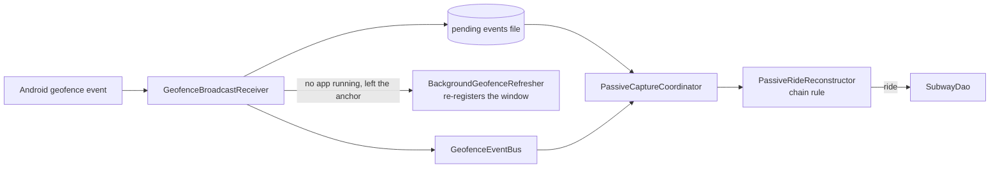

# Code tour

A walk through the Straphanger code, in the order you would meet it if you followed one ride from the phone to the screen. Paths are relative to the repository root and link to the files.

## 1. The shape of the project

```
straphanger/
├── shared/            Kotlin Multiplatform library: all UI, data and logic (Android + iOS)
├── androidApp/        The Android application: manifest, MainActivity, receivers, signing, Play
├── iosApp/            iOS shell (Info.plist, xcconfig). Not built yet; needs a Mac
├── tools/gtfs-import/ JVM command-line tool that generates the subway network from MTA data
├── docs/              Privacy policy, Play Console drafts, releasing, device testing, this tour
├── scripts/           check-listing.sh (Play listing text checks)
├── config/detekt/     Static analysis settings
└── version.properties The one place the version lives
```

Three Gradle modules are included in [settings.gradle.kts](../settings.gradle.kts):

| Module | What it is |
|---|---|
| `:shared` | A KMP library (`com.android.kotlin.multiplatform.library`). Almost all of the app. |
| `:androidApp` | The thing you install. Thin: it wires platform services into `:shared`'s `App()`. |
| `:tools:gtfs-import` | Offline generator. Its output is checked in as data. |

Android Gradle Plugin 9 does not let one module be both a library and an application, which is why the app is split from `:shared`. (The old name for the app module was `composeApp`; it no longer exists.)

The main idea: **`:shared` knows nothing about Android.** Where it needs the platform (geofences, notification access, location permission), it declares a small interface and `androidApp` implements it.

## 2. The data: a subway network as JSON

[nyc_subway_network.json](../shared/src/commonMain/composeResources/files/nyc_subway_network.json) is the whole subway: 496 stations grouped into 445 complexes, the segments between them, and route metadata (colors, names). It is generated, not hand-written.

**The generator** is in [tools/gtfs-import](../tools/gtfs-import/README.md):

- [GtfsReader.kt](../tools/gtfs-import/src/main/kotlin/com/straphanger/tools/gtfs/GtfsReader.kt) reads the MTA's GTFS zip (one small reader per table).
- [NetworkBuilder.kt](../tools/gtfs-import/src/main/kotlin/com/straphanger/tools/gtfs/NetworkBuilder.kt) builds the graph: station complexes, segments with real track distance from shape data, which routes stop where in each service period, and express expansion.
- [OutputModels.kt](../tools/gtfs-import/src/main/kotlin/com/straphanger/tools/gtfs/OutputModels.kt) is the JSON shape; [Main.kt](../tools/gtfs-import/src/main/kotlin/com/straphanger/tools/gtfs/Main.kt) is the command line.

Regenerating from the same input gives a byte-identical file, which is a good check after touching the tool.

**The loader** is [NycSubwayNetworkCatalog.kt](../shared/src/commonMain/kotlin/com/straphanger/app/data/gtfs/NycSubwayNetworkCatalog.kt), which parses the JSON into the types in [SubwayModels.kt](../shared/src/commonMain/kotlin/com/straphanger/app/data/gtfs/SubwayModels.kt): `SubwayStation`, `SubwaySegment`, `SubwayRouteInfo`, `SubwayNetworkData`, and the trip types (`TripLegRequest`, `ResolvedLegPath`, `ResolvedTripResult`, `AmbiguousRouteCandidate`).

## 3. Routing: from "A to B" to a ride

Everything starts with the [SubwayGraphEngine](../shared/src/commonMain/kotlin/com/straphanger/app/data/gtfs/SubwayGraphEngine.kt), a facade over the network. It looks things up and hands the hard work to two helpers:

- [RoutePathFinder.kt](../shared/src/commonMain/kotlin/com/straphanger/app/data/gtfs/RoutePathFinder.kt) is a route-aware Dijkstra search. The state is *(station, route you are riding)*, so changing trains costs `ROUTE_CHANGE_COST_MILES` (one mile-equivalent). That is why a one-seat ride beats an invented transfer.
- [TripResolver.kt](../shared/src/commonMain/kotlin/com/straphanger/app/data/gtfs/TripResolver.kt) turns a path into legs: it splits the path wherever the train changes (`legRequestsAlong`), then for each leg picks the route that served it, which stations it actually stopped at (express vs local), and a set of alternatives when the choice is genuinely ambiguous. Those alternatives become the "Confirm 4 Express / 6 Local" choices a user sees.
- [ServicePeriodInference.kt](../shared/src/commonMain/kotlin/com/straphanger/app/data/gtfs/ServicePeriodInference.kt) decides whether a timestamp is late night, weekend, rush hour or daytime, in New York time. The network stores which routes stop where *per period*.

## 4. Storing rides

A ride is a [RideEntity](../shared/src/commonMain/kotlin/com/straphanger/app/data/local/Entities.kt) with legs, segments and station stops (`CompleteRideRecord` bundles them). Despite the names, nothing is a database: rides are one JSON file.

- [SubwayDao.kt](../shared/src/commonMain/kotlin/com/straphanger/app/data/local/SubwayDao.kt) is the only way to read or change rides. It exposes flows for the UI and `RidePersistenceBackend` for storage. The rule it enforces: **save first, then publish**. If a write fails, memory is not changed and the user is told. While saves are blocked (see below), writes throw.
- [FileRidePersistenceBackend.kt](../shared/src/commonMain/kotlin/com/straphanger/app/data/local/FileRidePersistenceBackend.kt) writes `rides.json` safely: write `rides.json.tmp`, flush, fsync, rename the old file to `rides.json.bak`, move the new one into place.
- [RideSnapshotLoader.kt](../shared/src/commonMain/kotlin/com/straphanger/app/data/local/RideSnapshotLoader.kt) reads at startup. A missing, blank or corrupt file falls back to `.bak`. A corrupt file is renamed aside (`rides.corrupt-<ms>.json`) so it is never overwritten; if that rename fails, saves are blocked and the user sees a banner.
- [RideIds.kt](../shared/src/commonMain/kotlin/com/straphanger/app/data/local/RideIds.kt) makes collision-free ids.

[BackupExportManager.kt](../shared/src/commonMain/kotlin/com/straphanger/app/data/sync/BackupExportManager.kt) exports and restores rides as a file the user picks. There is no cloud service.

## 5. Three ways rides get created

All three end in the DAO, and all three can produce a "needs review" ride when the data is ambiguous.

### 5a. By hand and from sample data

[RideLogging.kt](../shared/src/commonMain/kotlin/com/straphanger/app/ui/RideLogging.kt) holds `RideLogController` and the quick-ride form: pick stations, resolve the trip through the engine (via a transfer if needed), save. [StarterRides.kt](../shared/src/commonMain/kotlin/com/straphanger/app/ui/StarterRides.kt) builds the three sample rides debug builds can load.

### 5b. Google Maps: Timeline files, shared routes, notifications

All in [data/capture](../shared/src/commonMain/kotlin/com/straphanger/app/data/capture/):

- [TimelineJsonImporter.kt](../shared/src/commonMain/kotlin/com/straphanger/app/data/capture/TimelineJsonImporter.kt) and [TimelineSegmentParser.kt](../shared/src/commonMain/kotlin/com/straphanger/app/data/capture/TimelineSegmentParser.kt) handle three file formats (Android on-device Timeline, iOS, and Takeout). Segments are snapped to stations, merged into trips across transfers, and de-duplicated against existing rides.
- [GoogleMapsShareParser.kt](../shared/src/commonMain/kotlin/com/straphanger/app/data/capture/GoogleMapsShareParser.kt) parses shared text ("From 14 St to 86 St via 4 train"), shortened `maps.app.goo.gl` links (it follows one redirect, the app's only network call), and `straphanger://` deep links. A station name that matches more than one complex ("86 St") is resolved with the named line when there is one, otherwise the ride is flagged for review.
- [NotificationSessions.kt](../shared/src/commonMain/kotlin/com/straphanger/app/data/capture/NotificationSessions.kt): Google Maps updates one ongoing notification many times per trip. `NotificationSessionTracker` keeps **one session per navigation notification**, from first post to removal, in a small file so a killed process doesn't lose it. A finished session becomes one ride (`CapturedRideRecorder` in [ui](../shared/src/commonMain/kotlin/com/straphanger/app/ui/CapturedRideRecorder.kt) does that). Not yet verified against real Google Maps notifications; see [DEVICE-TESTING.md](DEVICE-TESTING.md).

### 5c. Passive capture with geofences

The most involved feature. Idea: register geofences around nearby stations, and when you pass through two of them at train speed, record a ride.

- [DynamicGeofenceWindowManager.kt](../shared/src/commonMain/kotlin/com/straphanger/app/data/capture/DynamicGeofenceWindowManager.kt) has two classes.
  - `DynamicGeofenceWindowManager` picks the geofences to register: the 18 nearest station complexes plus one larger "anchor" geofence (19 total, under iOS's 20 limit). When you leave the anchor, it recomputes the window around you.
  - `PassiveRideReconstructor` turns station entries into rides with the **chain rule**. Entering a new complex extends the chain if the hop was at least 6 mph within 30 minutes. A chain closes after 15 idle minutes. A closed chain becomes a ride only if origin and end are different complexes, the trip took 2 to 120 minutes, and the distance, less two geofence radii (a walker is detected at the facing edges), is at least 0.3 mile at 6 mph or more. That last rule is what stops walks being recorded as rides.
- [PassiveCaptureCoordinator.kt](../shared/src/commonMain/kotlin/com/straphanger/app/data/capture/PassiveCaptureCoordinator.kt) runs it: registers the window, feeds entries to the reconstructor, closes idle chains on a timer, and saves rides. If a save fails, it keeps that chain's entries so the ride is retried on the next start.
- [PendingGeofenceEventStore.kt](../shared/src/commonMain/kotlin/com/straphanger/app/data/capture/PendingGeofenceEventStore.kt) is a file where the Android receiver appends station entries even when the app is not running. [JsonStateFile.kt](../shared/src/commonMain/kotlin/com/straphanger/app/data/capture/JsonStateFile.kt) is the shared safe-write helper behind it and the notification sessions; an unreadable file is renamed aside and logged, never silently reset.
- [GeofenceRegistrar.kt](../shared/src/commonMain/kotlin/com/straphanger/app/data/capture/GeofenceRegistrar.kt) is the interface the platform implements, plus `GeofenceEvent` and `GeofenceEventBus`.
- [BackgroundWindowRefresh.kt](../shared/src/commonMain/kotlin/com/straphanger/app/data/capture/BackgroundWindowRefresh.kt) is the pure "compute the next window" function the Android receiver uses when no coordinator is alive.



## 6. Statistics

[SubwayStatsCalculator.kt](../shared/src/commonMain/kotlin/com/straphanger/app/domain/stats/SubwayStatsCalculator.kt) is a pure function from rides plus the network to a `SubwayStatsSnapshot`: miles ridden and unique miles, line completion, boroughs, favourite stations, monthly trend, route pairs. Achievements are a table of `AchievementDefinition`s evaluated by `AchievementEngine` at the bottom of the file.

## 7. The UI

Compose Multiplatform, in `:shared`.

**Entry point.** [App.kt](../shared/src/commonMain/kotlin/com/straphanger/app/App.kt) is the one composable the platform calls. Its parameters are everything the platform supplies (see the KDoc): the geofence registrar, permission state, pending events, callbacks to open settings, the version name, and the `showDeveloperTools` flag. [AppChrome.kt](../shared/src/commonMain/kotlin/com/straphanger/app/AppChrome.kt) has the theme, header, bottom tabs and the storage-error banner. [MtaColors.kt](../shared/src/commonMain/kotlin/com/straphanger/app/ui/theme/MtaColors.kt) holds the colors and their contrast values.

**State.** [StraphangerViewModel.kt](../shared/src/commonMain/kotlin/com/straphanger/app/ui/StraphangerViewModel.kt) is a thin front. Its actions live in controllers that share one [StraphangerSession](../shared/src/commonMain/kotlin/com/straphanger/app/ui/StraphangerSession.kt) (the scope DAO writes run in, the DAO, the state flow and, once loaded, the network services):

| Controller | File |
|---|---|
| Tabs, map and stats choices | [ScreenNavigation.kt](../shared/src/commonMain/kotlin/com/straphanger/app/ui/ScreenNavigation.kt) |
| Logging, reviewing and deleting rides | [RideLogging.kt](../shared/src/commonMain/kotlin/com/straphanger/app/ui/RideLogging.kt) |
| Timeline import | [TimelineFileImport.kt](../shared/src/commonMain/kotlin/com/straphanger/app/ui/TimelineFileImport.kt) |
| Backup and restore | [BackupActions.kt](../shared/src/commonMain/kotlin/com/straphanger/app/ui/BackupActions.kt) |
| Passive capture | [PassiveCapture.kt](../shared/src/commonMain/kotlin/com/straphanger/app/ui/PassiveCapture.kt) |
| Shared routes and notification rides | [CapturedRideRecorder.kt](../shared/src/commonMain/kotlin/com/straphanger/app/ui/CapturedRideRecorder.kt) |

The UI state itself is [StraphangerUiState.kt](../shared/src/commonMain/kotlin/com/straphanger/app/ui/StraphangerUiState.kt). One rule worth knowing: every DAO write runs on the view model's dispatcher; only Timeline parsing runs on the compute dispatcher. [FileFailures.kt](../shared/src/commonMain/kotlin/com/straphanger/app/ui/FileFailures.kt) is where file and save failures become messages.

**Screens** (under [ui/](../shared/src/commonMain/kotlin/com/straphanger/app/ui/)):

- Map: [SubwayMapScreen.kt](../shared/src/commonMain/kotlin/com/straphanger/app/ui/map/SubwayMapScreen.kt), with [MapGeometry.kt](../shared/src/commonMain/kotlin/com/straphanger/app/ui/map/MapGeometry.kt) (projection, pan and zoom, nearest-station hit test) and [MapDrawing.kt](../shared/src/commonMain/kotlin/com/straphanger/app/ui/map/MapDrawing.kt).
- Stats: [StatsDashboardScreen.kt](../shared/src/commonMain/kotlin/com/straphanger/app/ui/stats/StatsDashboardScreen.kt).
- Rides: [RidesAndCaptureScreen.kt](../shared/src/commonMain/kotlin/com/straphanger/app/ui/rides/RidesAndCaptureScreen.kt) (log form, history, delete), and [RideReview.kt](../shared/src/commonMain/kotlin/com/straphanger/app/ui/rides/RideReview.kt), which builds the needs-review choices from a ride's real candidates.
- Import & Backup: [DataSourcesAndSyncScreen.kt](../shared/src/commonMain/kotlin/com/straphanger/app/ui/rides/DataSourcesAndSyncScreen.kt).
- About and licenses: [AboutScreen.kt](../shared/src/commonMain/kotlin/com/straphanger/app/ui/about/AboutScreen.kt).
- Disclosures shown before any permission prompt: [DisclosureScreens.kt](../shared/src/commonMain/kotlin/com/straphanger/app/ui/permissions/DisclosureScreens.kt).

Every interactive element has a `testTag`; the instrumented tests find things by tag, so don't rename them casually.

**Diagnostics.** [DiagnosticsLog.kt](../shared/src/commonMain/kotlin/com/straphanger/app/diagnostics/DiagnosticsLog.kt) is a tiny logger for failures that were handled but shouldn't go unnoticed. The sink defaults to `println`; on Android it is pointed at `Log.w`. Nothing in the code catches an exception and discards it.

## 8. The Android app

Everything here is in [androidApp/src/main/kotlin/com/straphanger/app](../androidApp/src/main/kotlin/com/straphanger/app/).

- [StraphangerApplication.kt](../androidApp/src/main/kotlin/com/straphanger/app/StraphangerApplication.kt): sets the diagnostics sink at process start, so it covers receivers and the listener too.
- [MainActivity.kt](../androidApp/src/main/kotlin/com/straphanger/app/MainActivity.kt): builds the registrar, file-backed stores and permission state and passes them to `App()`. It also receives text shared from Google Maps and hands it to `SharedRouteInbox`.
- [capture/](../androidApp/src/main/kotlin/com/straphanger/app/capture/):
  - `AndroidGeofenceRegistrar`: registers the geofence window with Play services.
  - `GeofenceBroadcastReceiver`: appends station entries to the pending file, forwards events, and (if the app isn't running and you left the anchor) asks `BackgroundGeofenceRefresher` to register a new window using `goAsync()` and a 20-second timeout.
  - `BootCompletedReceiver`: re-registers geofences after a reboot if capture is on and the permissions are still granted.
  - `GoogleMapsTransitNotificationListener`: reads only Google Maps navigation notifications and feeds the session tracker.
  - `NotificationAccess`, `PassiveCaptureStorage`, and [permissions/CapturePermissions.kt](../androidApp/src/main/kotlin/com/straphanger/app/permissions/CapturePermissions.kt): access checks and the persisted on/off choice (off by default).
- [AndroidManifest.xml](../androidApp/src/main/AndroidManifest.xml) declares the components. Auto Backup rules are in `res/xml`.

[androidApp/build.gradle.kts](../androidApp/build.gradle.kts) is where release engineering lives:

- **Versions.** `version.properties` gives `versionName`; the build derives `versionCode = major*1_000_000 + minor*1_000 + patch`. `./gradlew syncIosVersion` writes the same numbers for iOS.
- **Build types.** `debug` (suffix `.debug`, developer tools on), `releaseTest` (suffix `.releasetest`, a minified build used to run the device tests against R8 output) and `release` (`com.straphanger.app`, developer tools off).
- **Signing.** From `keystore.properties` or `STRAPHANGER_UPLOAD_*` environment variables. `checkReleaseSigning` fails the build when neither is present, unless you pass `-Pstraphanger.allowDebugSignedRelease=true`.
- **Shrinking.** R8 minify; keep rules in `proguard-rules.pro` (release) and `proguard-test-*.pro` (test-only, never in release).
- **Play.** Gradle Play Publisher reads the listing and release notes from `src/main/play`.

[.github/workflows](../.github/workflows) has CI (`kmp-ci.yml`: ktfmt, detekt, tests, debug APK, emulator tests) and `release.yml` (runs on a `v*` tag, builds the signed bundle, publishes to Play internal testing). [RELEASING.md](RELEASING.md) is the step-by-step.

## 9. Tests

| Where | What | Run with |
|---|---|---|
| `shared/src/commonTest` | Unit tests on small fake networks: routing, stats, DAO, capture, view model. Use [FixedClock](../shared/src/commonTest/kotlin/com/straphanger/app/testutil/FixedClock.kt) and [TestNetwork](../shared/src/commonTest/kotlin/com/straphanger/app/testutil/TestNetwork.kt). | `./gradlew :shared:testAndroidHostTest` |
| `shared/src/androidHostTest` | Tests against the real bundled network: routing on real stations (for example 120 to 235 is one leg on the 2 or 3), passive rides, share text. | same |
| `tools/gtfs-import/src/test` | The generator on a tiny GTFS feed. | `./gradlew :tools:gtfs-import:test` |
| `androidApp/src/androidTest` | Compose UI tests on a device or emulator: [SubwayTrackerEmulatorTest](../androidApp/src/androidTest/kotlin/com/straphanger/app/SubwayTrackerEmulatorTest.kt) and [RidePersistenceEmulatorTest](../androidApp/src/androidTest/kotlin/com/straphanger/app/RidePersistenceEmulatorTest.kt). They run under the AndroidX Test Orchestrator, so every test starts with empty app data. | `./gradlew :androidApp:connectedDebugAndroidTest` |

Quality gates, all run in CI: `./gradlew ktfmtCheck detekt checkIosVersion`. Formatting is ktfmt (Google style, 100 columns). Detekt runs with no baseline and no suppressions; the few settings that differ from the defaults are in [detekt.yml](../config/detekt/detekt.yml), each with a reason.

## 10. Where to start reading

- **To understand the app:** `App.kt`, then `StraphangerViewModel.kt` and one controller (`RideLogging.kt` is the clearest).
- **To understand why a ride looks the way it does:** `TripResolver.kt`, then `RoutePathFinder.kt`.
- **To understand passive capture:** `DynamicGeofenceWindowManager.kt` (read the `PassiveRideReconstructor` comment first), then `PassiveCaptureCoordinator.kt`, then `GeofenceBroadcastReceiver.kt`.
- **To understand what can go wrong with saved data:** `SubwayDao.kt` and `RideSnapshotLoader.kt`.
- **To change the subway data:** `tools/gtfs-import/README.md`.

## Known gaps

- iOS has never been built; the `iosMain` code and `iosApp` are unverified (see the README status table).
- The notification listener and geofence capture are tested only with simulated input; [DEVICE-TESTING.md](DEVICE-TESTING.md) says how to check them on a phone.
- Route search does not filter by time of day, so a late-night trip can be routed on a line that isn't running.
